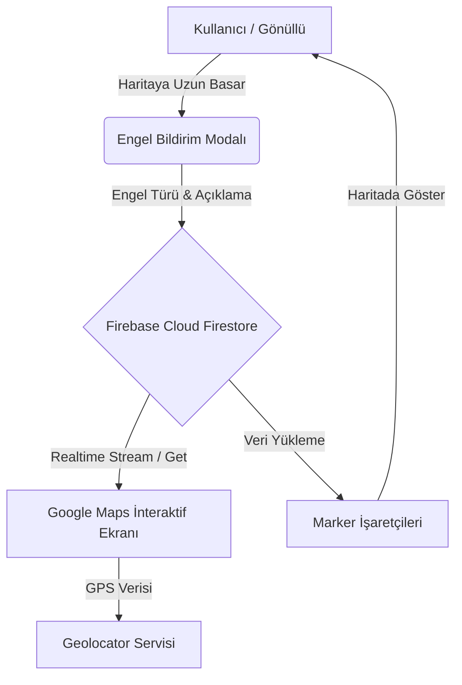

<div align="center">

  # ♿ Engelsiz Rota

  **Şehirleri Herkes İçin Erişilebilir Kılan Topluluk Destekli Mobil Harita Platformu**

  [](https://flutter.dev/)
  [](https://dart.dev/)
  [](https://firebase.google.com/)
  [](https://developers.google.com/maps)
  [](LICENSE)

  [Özellikler](#-özellikler) •
  [Mimari](#-uygulama-mimarisi) •
  [Kurulum](#-kurulum-ve-çalıştırma) •
  [Firebase & Google Maps](#-firebase--google-maps-kurulumu) •
  [Katkıda Bulunma](#-katkıda-bulunma)

</div>

---

## 📖 Hakkında

**Engelsiz Rota**, fiziksel ve görme engelli bireylerin kent içi günlük hareketliliğini kolaylaştırmak amacıyla tasarlanmış açık kaynaklı mobil uygulamadır.

Şehirlerde karşılaşılan bozuk erişim rampaları, kaldırımlara hatalı park etmiş araçlar ve yüksek kaldırımlar gibi fiziksel engeller, kullanıcılar ve gönüllüler tarafından harita üzerinde anlık olarak işaretlenir. Toplanan veriler **Firebase Cloud Firestore** üzerinde canlı tutularak tüm kullanıcıların erişilebilir ve güvenli rotalar oluşturmasına imkan tanır.

---

## ✨ Özellikler

- 🗺️ **Canlı Canlı Canlı İnteraktif Harita**: `Google Maps API` entegrasyonu sayesinde çevrenizdeki tüm engel noktalarını gerçek zamanlı takip edin.
- 📍 **Konum Tabanlı Bildirim**: Haritada bir noktaya uzun basarak kolayca yeni engel bildirimi oluşturun.
- 🚨 **Kategorize Edilmiş Engel Tipleri**:
  - 🛠️ Bozuk / Eksik Rampa
  - 📐 Yüksek / Erişilemez Kaldırım
  - 🚗 Hatalı / Kaldırım Üstü Park
  - 📝 Detaylı metin açıklamaları ekleme
- 🔥 **Gerçek Zamanlı Veritabanı**: Bildirilen engeller anında Firestore'a kaydedilir ve tüm aktif kullanıcılarda turuncu marker olarak belirir.
- 🎯 **Akıllı Konum Odaklama**: `Geolocator` desteği ile tek dokunuşla mevcut GPS konumunuza odaklanın.
- 🏅 **Gönüllü & İstatistik Paneli**: Aktif engel sayıları, çözülen engeller, kişisel bildirim geçmişi ve topluluk rozetleri.

---

## 🏗️ Uygulama Mimarisi



---

## 🛠️ Teknolojik Altyapı ve Bağımlılıklar

| Paket / Servis | Sürüm | Kullanım Amacı |
| :--- | :--- | :--- |
| **`flutter`** | `>=3.8.1` | Çapraz platform mobil UI framework'ü |
| **`google_maps_flutter`** | `^2.14.2` | Harita gösterimi, özel işaretçi (marker) ve kamera yönetimi |
| **`geolocator`** | `^14.0.2` | Anlık GPS konum alma ve konum izinleri yönetimi |
| **`cloud_firestore`** | `^6.1.2` | Bulut tabanlı canlı NoSQL veritabanı |
| **`firebase_core`** | `^4.4.0` | Firebase platform ilklendirme |
| **`flutter_polyline_points`** | `^3.1.0` | Harita üzerinde rota hat çizimleri altyapısı |

---

## 📁 Proje Dizin Yapısı

```
engelsiz_rota/
├── android/                   # Android native platform konfigürasyonları
├── ios/                       # iOS native platform konfigürasyonları
├── lib/                       # Dart uygulama kaynak kodları
│   ├── firebase_options.dart # Firebase platform bağlayıcı konfigürasyonu
│   └── main.dart              # Harita UI, Firestore servis entegrasyonu ve state yönetimi
├── pubspec.yaml               # Proje paket bağımlılıkları ve varlık tanımları
└── README.md                  # Proje dokümantasyonu
```

---

## 🚀 Kurulum ve Çalıştırma

### Ön Gereksinimler
- **[Flutter SDK](https://docs.flutter.dev/get-started/install)** (`>= 3.8.1`)
- **[Dart SDK](https://dart.dev/get-sdk)**
- **Android Studio** veya **VS Code** (Flutter kütüphane eklentileriyle)
- Google Cloud Console & Firebase Hesabı

### Adım Adım Kurulum

1. **Projeyi Klonlayın:**
   ```bash
   git clone https://github.com/iamhilals/engelsiz_rota.git
   cd engelsiz_rota
   ```

2. **Gerekli Paketleri İndirin:**
   ```bash
   flutter pub get
   ```

3. **Google Maps API Anahtarını Yapılandırın:**
   - Android için `android/app/src/main/AndroidManifest.xml` dosyasındaki meta-data alanına API key'inizi ekleyin:
     ```xml
     <meta-data android:name="com.google.android.geo.API_KEY"
                android:value="YOUR_GOOGLE_MAPS_API_KEY"/>
     ```

4. **Uygulamayı Çalıştırın:**
   ```bash
   flutter run
   ```

---

## 🔧 Firebase & Google Maps Kurulumu

### Cloud Firestore Şeması
Uygulama Firebase üzerinde `engeller` adında bir koleksiyon (collection) kullanmaktadır. Veri yapısı şu şekildedir:

```json
{
  "konum": "GeoPoint(latitude, longitude)",
  "tur": "Bozuk Rampa | Yüksek Kaldırım | Hatalı Park",
  "aciklama": "Örnek engel açıklaması",
  "tarih": "FieldValue.serverTimestamp()"
}
```

---

## 🤝 Katkıda Bulunma

Topluluk katkılarına tamamen açığız! Katkıda bulunmak için şu adımları izleyebilirsiniz:

1. Bu depoyu çatallayın (**Fork**).
2. Yeni bir özellik dalı oluşturun:
   ```bash
   git checkout -b feature/HarikaOzellik
   ```
3. Değişikliklerinizi kaydedin:
   ```bash
   git commit -m 'feat: Harika özellik eklendi'
   ```
4. Dalınızı uzak depoya gönderin:
   ```bash
   git push origin feature/HarikaOzellik
   ```
5. Bir **Pull Request (PR)** açın.

---

## 📜 Lisans

Bu proje **MIT Lisansı** ile lisanslanmıştır. Detaylar için `LICENSE` dosyasına göz atabilirsiniz.

<div align="center">
  <sub>Engelsiz bir gelecek için toplulukla geliştirilmiştir. ❤️</sub>
</div>
